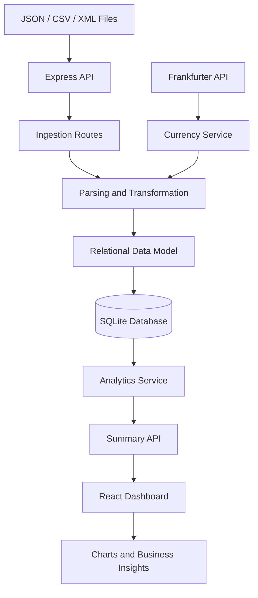

# DataFlow — Order Analytics Dashboard & Ingestion Pipeline

**Transform raw business data into meaningful insights.**

DataFlow is a full-stack data ingestion and analytics platform designed to import business data from multiple file formats, transform and organize it into a relational database, and present actionable order analytics through an interactive dashboard.

The platform combines a React-based frontend with a Node.js and Express backend, providing a foundation for exploring order performance, customer behavior, product sales, shipment data, and currency-normalized revenue.

---

## Table of Contents

- [Overview](#overview)
- [Key Features](#key-features)
- [System Architecture](#system-architecture)
- [Technology Stack](#technology-stack)
- [Project Structure](#project-structure)
- [Getting Started](#getting-started)
- [Environment Variables](#environment-variables)
- [API Reference](#api-reference)
- [Database Design](#database-design)
- [Data Processing Pipeline](#data-processing-pipeline)
- [Deployment](#deployment)
- [Troubleshooting](#troubleshooting)
- [Future Improvements](#future-improvements)
- [Author](#author)

## Overview

Modern businesses generate data across multiple systems and formats. Analyzing this information becomes difficult when datasets are inconsistent, distributed, or not immediately suitable for reporting.

DataFlow addresses this challenge with a data pipeline that ingests JSON, CSV, and XML files, processes their contents, stores structured records, and exposes analytics through a centralized dashboard.

### What DataFlow does

1. **Ingests data:** Accepts business datasets in JSON, CSV, and XML formats.
2. **Transforms data:** Processes incoming records into a consistent structure.
3. **Organizes relationships:** Stores customers, products, orders, order items, and shipments in relational tables.
4. **Normalizes currencies:** Integrates exchange-rate data through the Frankfurter API.
5. **Generates analytics:** Exposes summary metrics through backend API endpoints.
6. **Visualizes insights:** Presents business information through a React dashboard.

## Key Features

### Multi-Format Data Ingestion

- Import structured data from JSON files.
- Process tabular data from CSV files.
- Parse XML datasets.
- Handle data transformation before database insertion.
- Provide dedicated API endpoints for different input formats.

### Order Analytics

- Centralized order analytics and summary metrics.
- Customer and product data relationships.
- Order-item analysis.
- Shipment data integration.
- A foundation for understanding sales performance and operational trends.

### Currency Conversion

- Integrates the Frankfurter API for exchange-rate data.
- Supports currency normalization within the data-processing workflow.
- Helps make financial data from different currencies easier to compare.

*Currency conversion behavior depends on the implementation and availability of exchange-rate data.*

### Interactive Dashboard

- React-based frontend built with Vite.
- Tailwind CSS for interface styling.
- Recharts for data visualization.
- Integration with backend analytics APIs.
- Separation between the presentation layer and data-processing logic.

### Relational Data Storage

- SQLite database powered by `better-sqlite3`.
- Structured tables for core business entities.
- Relational joins for combining information across datasets.
- Persistent local database storage during local development.

## System Architecture



The architecture separates ingestion, transformation, database operations, analytics, and visualization into distinct responsibilities. This makes the application easier to maintain and extend.

## Technology Stack

| Layer | Technologies |
|---|---|
| Frontend | React 19, Vite |
| Styling | Tailwind CSS |
| Data visualization | Recharts |
| Backend | Node.js, Express.js |
| Database | SQLite, `better-sqlite3` |
| Data processing | JavaScript, custom transformation services |
| File formats | JSON, CSV, XML |
| Currency data | Frankfurter API |
| Version control | Git, GitHub |
| Frontend deployment | Vercel |
| Backend deployment | Render |

## Project Structure

```text
DataFlow-Order-Analytics-ETL/
│
├── frontend/
│   ├── src/
│   │   ├── components/
│   │   ├── services/
│   │   ├── pages/
│   │   └── ...
│   ├── public/
│   ├── package.json
│   └── vite.config.js
│
├── backend/
│   ├── services/
│   │   ├── analytics.service.js
│   │   ├── currency.service.js
│   │   └── transformation.service.js
│   ├── routes/
│   │   ├── analytics.routes.js
│   │   └── ingest.routes.js
│   ├── package.json
│   └── ...
│
├── .gitignore
├── vercel.json
└── README.md
```

*The tree illustrates the main architectural components. Adjust individual paths to match the current repository if your folders differ.*

## Getting Started

### Prerequisites

Install the following before running the project:

- [Node.js](https://nodejs.org/) — preferably a version supported by both dependencies and deployment platforms.
- npm, included with Node.js.
- [Git](https://git-scm.com/) for cloning the repository.

### 1. Clone the repository

```bash
git clone https://github.com/lucius-lt/DataFlow-Order-Analytics-ETL.git

cd DataFlow-Order-Analytics-ETL
```

### 2. Set up the backend

Open a terminal in the project root and run:

```bash
cd backend
npm install
```

Configure any required environment variables and verify the database configuration before starting the server.

Start the backend using the script defined in `backend/package.json`. If the project defines a `start` script, run:

```bash
npm start
```

For a development script named `dev`, run:

```bash
npm run dev
```

The API is expected to run on port `5000` in the local configuration described by this project. Confirm the actual port in the backend entry point or environment configuration.

### 3. Set up the frontend

Open another terminal:

```bash
cd frontend
npm install
```

Create a `.env` file in the `frontend/` directory if your frontend requires an API base URL.

```env
VITE_API_URL=http://localhost:5000
```

Ensure your frontend code reads `VITE_API_URL` and uses it when making API requests. If the application currently uses a different variable name, keep that name consistent instead.

Start the frontend:

```bash
npm run dev
```

Vite will display the local development URL in your terminal, typically:

```text
http://localhost:5173
```

Open that URL in your browser.

### 4. Run the complete application

For local development, both services need to be running:

| Service | Typical local URL |
|---|---|
| Frontend | `http://localhost:5173` |
| Backend | `http://localhost:5000` |

The frontend communicates with the backend through HTTP requests. If requests fail, check the backend status, API base URL, and CORS configuration.

## Environment Variables

Configure environment variables according to your deployment environment.

### Frontend

| Variable | Purpose | Example |
|---|---|---|
| `VITE_API_URL` | Base URL of the backend API | `http://localhost:5000` |

For production, replace the local URL with your deployed Render backend URL.

Example:

```env
VITE_API_URL=https://your-backend.onrender.com
```

This is an example URL, not an actual deployment address.

### Backend

Configure the backend's supported variables based on its implementation.

| Variable | Purpose |
|---|---|
| `PORT` | Port on which the Express server listens, if configurable |
| `NODE_ENV` | Runtime environment, such as `production` |
| `FRANKFURTER_API_URL` | Optional configurable base URL, if supported by the currency service |
| `DATABASE_PATH` | Optional database file path, if supported by the application |

Do not add variables that your code does not use. Never commit credentials, private API keys, or sensitive environment files to GitHub.

## API Reference

The backend exposes endpoints for data ingestion and analytics.

### Data Ingestion

| Method | Endpoint | Purpose |
|---|---|---|
| `POST` | `/api/ingest/json` | Ingest JSON data |
| `POST` | `/api/ingest/csv` | Ingest CSV data |
| `POST` | `/api/ingest/xml` | Ingest XML data |

### Analytics

| Method | Endpoint | Purpose |
|---|---|---|
| `GET` | `/api/analytics/summary` | Retrieve analytics summary data |

The exact request format, response structure, validation rules, and error codes depend on the route implementations.

### Example: Request the analytics summary

```bash
curl http://localhost:5000/api/analytics/summary
```

### Example: Ingest JSON

The following illustrates the HTTP request structure. Adapt the payload to the schema expected by your ingestion route.

```bash
curl -X POST http://localhost:5000/api/ingest/json \
  -H "Content-Type: application/json" \
  -d '{"data": []}'
```

A successful request depends on the route's expected input format and validation rules.

For file-based CSV or XML ingestion, consult the route implementation to determine whether it expects a multipart upload, raw content, or another request format.

## Database Design

DataFlow uses SQLite to store structured business data.

The main relational entities are:

| Table | Responsibility |
|---|---|
| `customers` | Customer information |
| `products` | Product information |
| `orders` | Order-level records |
| `order_items` | Products and quantities associated with orders |
| `shipments` | Shipment and delivery-related records |

These entities allow the application to combine order, customer, product, and shipment information for analysis.

### Why relational modeling?

Relational modeling helps reduce unnecessary duplication, maintain consistent relationships, and support queries that combine multiple business entities.

For example, order items can connect orders with products, allowing analytical queries to combine order information with product details.

### Database persistence

The application uses SQLite through `better-sqlite3`. During local development, database records are stored in a local database file.

For production deployment, ensure the database file is stored on persistent storage or migrate to a managed database appropriate for the deployment environment. A temporary deployment filesystem should not be assumed to preserve uploaded data across restarts or redeployments.

## Data Processing Pipeline

The ingestion and analytics workflow follows these stages:

**Stage 1 — Input**

Receive data in JSON, CSV, or XML format.

**Stage 2 — Parsing**

Read the incoming content and extract records from the supplied format.

**Stage 3 — Transformation**

Convert incoming records into the structure expected by the database and application services.

**Stage 4 — Storage**

Insert or update records in the relational database according to the implemented ingestion logic.

**Stage 5 — Analytics**

Query the stored data and calculate the summary metrics exposed by the analytics API.

**Stage 6 — Visualization**

Fetch the resulting data in the frontend and present it through dashboard components and charts.

**Stage 7 — Currency normalization**

Where applicable, integrate exchange-rate information from the Frankfurter API into the currency-processing workflow.

## Deployment

The application is designed to be deployed as two separate services.

### Frontend — Vercel

1. Import the GitHub repository into Vercel.
2. Set the root directory to `frontend`.
3. Select the Vite framework preset.
4. Use `npm run build` as the build command.
5. Use `dist` as the output directory.
6. Configure `VITE_API_URL` with the public URL of the deployed backend.
7. Deploy the frontend.

If you change `VITE_API_URL`, rebuild and redeploy the frontend so the updated value is included in the Vite build.

### Backend — Render

1. Create a new Web Service on Render.
2. Connect the GitHub repository.
3. Set the root directory to `backend`.
4. Configure the build command as `npm install`, unless your project requires a different command.
5. Set the start command to the command defined in `backend/package.json`.
6. Configure the required backend environment variables.
7. Configure CORS to allow requests from your deployed Vercel frontend.
8. Configure persistent storage for SQLite or use a managed database.
9. Deploy and verify the API endpoints.

### Production connection

The frontend should send requests to the deployed backend rather than `localhost`.

```text
Vercel frontend
       |
       | HTTPS API requests
       v
Render Express backend
       |
       v
SQLite / configured persistent database
       |
       v
Analytics and ingestion services
```

## Troubleshooting

### Frontend cannot fetch analytics

- Verify that the Render backend has deployed successfully.
- Check that `VITE_API_URL` contains the correct backend base URL.
- Confirm that the frontend's API client uses that variable.
- Inspect browser developer tools for failed requests.

### CORS errors

Configure the Express application to permit requests from the deployed frontend origin. Avoid allowing arbitrary origins in production unless there is a deliberate reason to do so.

### SQLite database errors

- Verify that the database file path is correct.
- Ensure the runtime can access the database file.
- Check that required directories exist and have appropriate permissions.
- Verify that the database persists on the configured storage volume.

### Deployment fails during installation or build

- Check the deployment logs.
- Verify the root directory.
- Ensure the correct `package.json` and lockfile are present.
- Confirm that the Node.js version is compatible with the dependencies.

### Currency conversion fails

- Verify network access to the Frankfurter API.
- Check the requested currencies and available exchange-rate data.
- Handle unavailable rates and API errors appropriately.

## Future Improvements

Potential enhancements include:

- Automated data validation and schema checks.
- More detailed analytics and customizable date filters.
- Improved ingestion error reporting.
- Background processing for large datasets.
- Automated data-quality checks and duplicate detection.
- Authentication and role-based access control.
- Exportable analytics reports.
- Migration to managed PostgreSQL for production workloads.
- Automated testing and continuous integration.
- Improved monitoring and structured logging.

## Author

**Niyati Soni**

- GitHub: [lucius-lt](https://github.com/lucius-lt)
- Project Repository: [DataFlow — Order Analytics ETL](https://github.com/lucius-lt/DataFlow-Order-Analytics-ETL)

---

*DataFlow demonstrates a full-stack approach to data ingestion, transformation, relational data modeling, API development, and business analytics visualization.*

